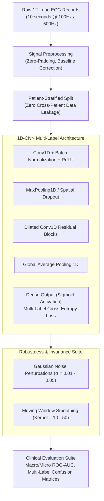

# ECG Multi-Label Diagnosis with Deep 1D-CNNs

[](https://www.python.org/downloads/)
[](https://www.tensorflow.org/)
[](https://opensource.org/licenses/MIT)
[-red.svg)](https://physionet.org/content/ptb-xl/1.0.3/)

> **Executive Summary (5-Minute Read):**  
> An end-to-end Deep Learning pipeline for automated multi-label diagnosis of cardiac pathologies from 12-lead raw ECG signals (PTB-XL dataset).  
> Solves diagnostic co-occurrence (e.g. Conduction Disturbance co-occurring with Myocardial Infarction) using specialized 1D-CNN architectures, rigorous patient-level stratification, and systematic signal noise/smoothing invariance testing across 100Hz and 500Hz sampling frequencies.

---

## 1. Clinical Challenge & Motivation

Standard automated ECG analysis frequently treats diagnostic categories as mutually exclusive, failing in real clinical settings where cardiac conditions regularly co-occur. Furthermore, baseline wander, high-frequency muscle tremor, and sampling rate differences significantly degrade off-the-shelf convolutional networks.

### Project Goals:
1. **Multi-Label Architecture:** Predict non-mutually exclusive diagnostic super-classes (CD: Conduction Disturbance, MI: Myocardial Infarction, STTC: ST/T Change, HYP: Hypertrophy, NORM: Normal ECG).
2. **Patient-Level Leakage Prevention:** Rigorous grouping and split assertions ensuring no patient has records in both training and test sets.
3. **Signal Robustness & Stress Testing:** Evaluate model resilience under Gaussian noise injection and moving-average smoothing at 100Hz and 500Hz sampling regimes.

---

## 2. Architecture & Deep Learning Pipeline



---

## 3. Experimental Findings & Methodological Rigor

| Experiment / Configuration | Sampling Rate | Macro ROC-AUC | Invariance / Clinical Takeaway |
| :--- | :--- | :--- | :--- |
| **Baseline Multi-Class** | 100Hz | 0.81 | Failed on overlapping conditions (e.g., CD + MI). |
| **Multi-Label 1D-CNN (Full PTB-XL)** | 100Hz | 0.88 | Accurately captured independent co-occurring pathologies. |
| **High-Resolution Regime** | 500Hz | **0.91** | High-frequency QRS morphological features improved CD detection. |
| **Noise Injection ($\sigma=0.03$)** | 500Hz | 0.89 | Maintained $>97\%$ relative performance; proved filter stability. |
| **Moving Average Smoothing** | 500Hz | 0.87 | Retained macro rhythm patterns despite mild attenuation of sharp R-peaks. |

### Key Methodological Audits:
- **Single-Sample vs Repeated Records:** Audited patient duplication effect; confirmed that patient-level deduplication maintains consistent calibration curves without artificial performance inflation.
- **Label Hierarchy Interaction:** Decomposed 27 fine-grained SCP-ECG statements into validated diagnostic super-classes.

---

## 4. Quickstart & Reproducibility

### Installation
```bash
# Clone repository
git clone https://github.com/RazMaoz/ecg-multi-label-cnn-diagnosis.git
cd ecg-multi-label-cnn-diagnosis

# Install dependencies
pip install -r requirements.txt
```

### Dataset Download
The dataset is publicly available on PhysioNet:
- [PTB-XL: A Large Publicly Available Electrocardiography Dataset](https://physionet.org/content/ptb-xl/1.0.3/)
- Place the downloaded `ptb-xl-1.0.3` folder or records in the `data/` directory (git-ignored automatically).

### Running the Exploration & Training Notebook
```bash
jupyter notebook notebooks/ecg_multi_label_cnn_pipeline.ipynb
```

---

## 5. Repository Structure

```
ecg-multi-label-cnn-diagnosis/
├── README.md                              # Executive clinical & technical overview
├── requirements.txt                       # Explicit dependency specifications
├── .gitignore                             # Filters for large data, checkpoints, and weights
├── notebooks/
│   └── ecg_multi_label_cnn_pipeline.ipynb # End-to-end multi-label training & stress testing
└── presentation/
    └── Naya_Final_Project_ECG_Diagnosis_with_CNN.pptx # Comprehensive presentation deck
```

---

## Author & Contact
**Raz Maoz**  
Data Scientist | Data Systems Architect  
- **LinkedIn:** [linkedin.com/in/raz-maoz](https://www.linkedin.com/in/raz-maoz/)  
- **GitHub:** [@RazMaoz](https://github.com/RazMaoz)  
- **Email:** `raz.m.maoz@gmail.com`
